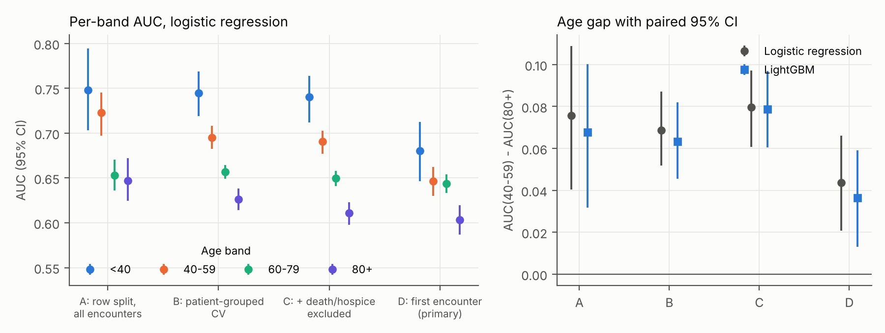
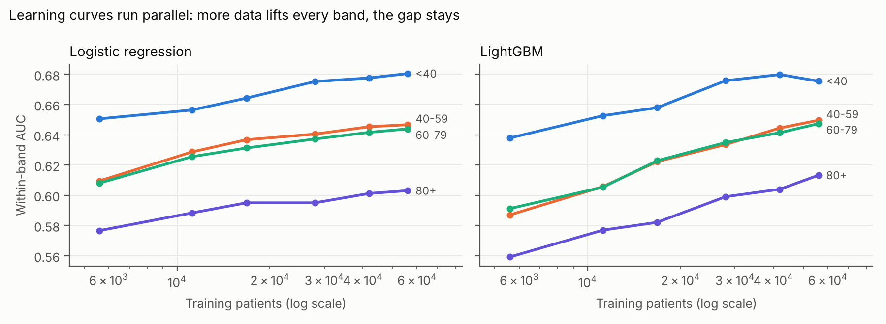
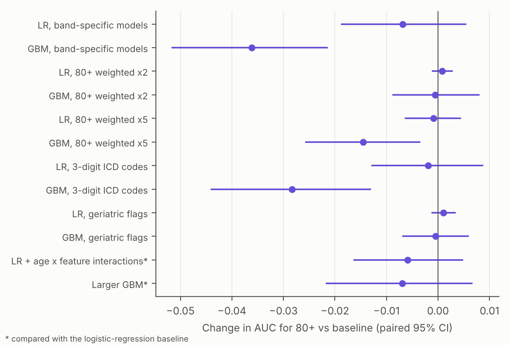

# Age gap in readmission-model discrimination: a patient-level audit

**Question.** On the UCI Diabetes 130-US Hospitals data, does a 30-day readmission model discriminate worse for the oldest patients? If it does, why, and can the gap be closed?

**Answer, in one paragraph.** Yes. In the standard patient-level cohort (first encounter per patient, deaths and hospice excluded; 69,990 patients), AUC is 0.647 for ages 40-59 and 0.603 for 80+, a gap of 0.044 (paired 95% CI 0.021 to 0.066). The usual encounter-level analysis roughly doubles the gap, mainly because of repeat admitters, not leakage. The gap is not explained by outcome rarity, label definition, sample size or model capacity. It sits in the part of feature space occupied by elderly patients, and band-specific models, reweighting, finer ICD codes and geriatric flags do not close it. Calibration-in-the-large is fine for every age, but the calibration slope for 80+ is 0.72.

## Start here

| If you want to... | Open |
|---|---|
| Read the paper | [`paper/preprint.pdf`](paper/preprint.pdf) |
| See the analysis plan, fixed before any result | [`PLAN.md`](PLAN.md) (commit 705c5db; deviations logged at the end) |
| Check a specific number | [`results/`](results/): one CSV per analysis, plus a log per phase |
| Reproduce everything | `bash run_all.sh` (instructions below) |

## Key results

| | Logistic regression | LightGBM |
|---|---|---|
| AUC, ages 40-59 | 0.647 [0.630, 0.662] | 0.650 [0.633, 0.665] |
| AUC, ages 80+ | 0.603 [0.587, 0.620] | 0.613 [0.597, 0.630] |
| Gap (paired 95% CI) | **0.044 [0.021, 0.066]** | **0.036 [0.013, 0.059]** |
| Gap, encounter-level design (for comparison) | 0.076 [0.040, 0.109] | 0.068 [0.032, 0.100] |

| Explanation tested | Verdict |
|---|---|
| Outcome rarity | Ruled out: readmission is more common in 80+ (10.6% vs 7.2%) |
| Outcome definition | Ruled out: the gap persists under two alternative definitions |
| Sample size (variance) | Ruled out: parallel learning curves; at equal n the gap is 0.632 vs 0.589 |
| Model capacity (bias) | Ruled out: four model classes give gaps of 0.036 to 0.048 |
| Case mix | Gap confined to profiles found mainly among the elderly (exploratory) |
| Interventions | None raised AUC for 80+ (band-specific models, reweighting, ICD codes, geriatric flags) |





## Run

```bash
python3 -m pip install -r requirements.txt
bash run_all.sh        # run from research/; reads ../data/diabetic_data.csv; about 25 minutes on 2 CPU cores
```

| Script | Phase | Main output |
|---|---|---|
| `01_leakage.py` | 1. Patient-level cohort and splits; gap under four designs | `results/p1_leakage.csv` |
| `02_cheap_explanations.py` | 2. Base rates, label definitions, case mix, discharge destination, calibration | `results/p2_*.csv` |
| `03_decomposition.py` | 3. Learning curves, matched-n models, model class, k-NN noise, importance | `results/p3_*.csv` |
| `04_interventions.py` | 4. Band-specific models, reweighting, richer features, geriatric flags | `results/p4_*.csv` |
| `05_figures.py` | Figures 1-3 | `figures/` |

All shared choices (cohort, bands, features, models, folds, bootstrap) live in `src/common.py`.

```
research/
  PLAN.md            pre-registered analysis plan and logged deviations
  run_all.sh         regenerates every number and figure
  src/common.py      cohort, features, models, CV, paired bootstrap
  scripts/           01-05, one script per phase
  results/           CSV tables and logs for every analysis
  figures/           figures 1-3 (PNG and vector PDF)
  paper/             preprint.pdf and its LaTeX source
```

## Relation to the capstone

This folder extends [Python-Capstone-Project](https://github.com/Archit733/Python-Capstone-Project) and the pipeline in the rest of this repository. The capstone used an encounter-level single split and reported AUC 0.81 for ages 20-29 against 0.58 for ages 90+. Under the patient-level design here, those figures are 0.70 and 0.54. The capstone's retracted "diagnosis complexity" explanation is replaced by the decomposition above.
